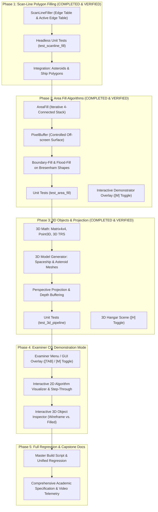

# Computer Graphics Course Outcome 3 (CG CO-3) — Master Implementation Roadmap
**Project:** AirStriker Enhance — Capstone Engineering Project  
**Module:** Computer Graphics Lab (CGL / C++ & OpenGL)  
**Status:** In Progress (Phases 1, 2, and 3 Completed & Verified)  
**Last Updated:** October 26, 2026  

---

## 1. Curricular Objectives & Scope Definition

Course Outcome 3 (CG CO-3) focuses on **Polygon Filling, Area Filling, 2D/3D Object Generation, and Geometric Viewing Pipelines**. This roadmap expands the AirStriker graphics engine to incorporate all required academic algorithms, ensuring they are genuine software implementations (not merely OpenGL wrappers) and fully integrated into playable 60 FPS gameplay.

---

## 2. Existing Codebase Audit & Reuse Strategy

The existing AirStriker CGL codebase provides battle-tested rasterization and math foundations that will be directly reused without duplication:

| Subsystem / Feature | Source File | Existing Implementation | Planned CO-3 Reuse |
|---|---|---|---|
| **Bresenham Line** | [`CGL/src/Bresenham.h`](file:///Users/nishant/airstrikeenhance/CGL/src/Bresenham.h) [`CGL/src/Bresenham.cpp`](file:///Users/nishant/airstrikeenhance/CGL/src/Bresenham.cpp) | Integer error ($\Delta x - \Delta y$), 8-octant traversal, `calculateLine()` and `renderLine()`. | Used for horizontal span filling in Scan-Line, 3D wireframe edges, and boundary perimeter drawing in AreaFill. |
| **Bresenham Circle** | [`CGL/src/Bresenham.h`](file:///Users/nishant/airstrikeenhance/CGL/src/Bresenham.h) [`CGL/src/Bresenham.cpp`](file:///Users/nishant/airstrikeenhance/CGL/src/Bresenham.cpp) | Mid-point decision ($d_0 = 1 - r$), 8-way symmetry, `calculateCircle()`, `renderCircle()`. | Reused to draw closed boundaries for the Boundary-Fill algorithm (Shield Aura and inspection demonstrator). |
| **2D Transformations** | [`CGL/src/Renderer.h`](file:///Users/nishant/airstrikeenhance/CGL/src/Renderer.h) [`CGL/src/Renderer.cpp`](file:///Users/nishant/airstrikeenhance/CGL/src/Renderer.cpp) | Translation, Scaling, Rotation, Compound TRS pipeline (`transformPoint()`). | Reused for 2D entity kinematics and basis for 3D affine matrix transformations. |
| **Player Ship Model** | [`Renderer.cpp:L132-L187`](file:///Users/nishant/airstrikeenhance/CGL/src/Renderer.cpp#L132-L187) | Composite fuselage, swept wings, thruster flame, diamond cockpit canopy. | Cockpit canopy filled via genuine Scan-Line algorithm. |
| **Enemy Ship Models** | [`Renderer.cpp:L197-L321`](file:///Users/nishant/airstrikeenhance/CGL/src/Renderer.cpp#L197-L321) | Procedural Drone, Fighter, and Boss silhouettes with multi-segment armor plates. | Energy core and main chassis filled via genuine Scan-Line algorithm. |
| **Asteroid Geometry** | [`Renderer.cpp:L484-L529`](file:///Users/nishant/airstrikeenhance/CGL/src/Renderer.cpp#L484-L529) | 10-vertex irregular radial sector polygon with cracking fissures. | Primary target for Scan-Line Polygon Filling and Area-Fill demonstrator. |
| **Energy Shield Ring** | [`Renderer.cpp:L568-L581`](file:///Users/nishant/airstrikeenhance/CGL/src/Renderer.cpp#L568-L581) | Concentric Bresenham circle and dashed pulse ring. | Primary target for Boundary-Fill and Flood-Fill algorithms. |

---

## 3. Phased Implementation Roadmap & Dependency Graph

---

## 4. Phase-by-Phase Technical Specifications

### Phase 1: Genuine Scan-Line Polygon Filling (Active)
* **Objective:** Implement a textbook scan-line polygon fill algorithm utilizing an **Edge Table (ET)** and **Active Edge Table (AET)** with inverse slopes ($\frac{\Delta x}{\Delta y}$) and parity-rule pair spans.
* **Deliverables:**
  * `CGL/src/ScanLineFiller.h` & `CGL/src/ScanLineFiller.cpp`.
  * `calculateScanlineSpans()`: Pure algorithmic function returning discrete horizontal scanline spans $(y, x_{\text{start}}, x_{\text{end}})$ for headless testing.
  * `renderFilledPolygon()`: Rasterization function rendering horizontal pixel spans.
  * Integration into `Renderer::renderAsteroid()` and ship polygon fills.
  * Comprehensive test suite `CGL/tests/test_scanline_fill.cpp`.
* **Dependencies:** None (builds on existing `Point2D`).

### Phase 2: Area Filling Algorithms (Flood-Fill & Boundary-Fill)
* **Objective:** Implement iterative 4-connected and 8-connected Seed-Fill algorithms without recursion stack overflows.
* **Deliverables:**
  * `CGL/src/AreaFill.h` & `CGL/src/AreaFill.cpp`.
  * `boundaryFill4()`: Expands outward from an interior seed point until reaching a defined boundary color (paired with `Bresenham::renderCircle`).
  * `floodFill4()`: Replaces all adjacent connected pixels of an interior target color.
  * Integration into Energy Shield aura and HUD gauges.
  * Unit test suite `CGL/tests/test_area_fill.cpp`.
* **Dependencies:** Requires Phase 1 and existing `Bresenham` circle rendering.

### Phase 3: Custom 3D Object Generation & Perspective Viewing Pipeline
* **Objective:** Create true 3D models with vertex buffers, edge lists, polygonal face indices, 3D affine transformations, perspective projection, and depth buffering.
* **Deliverables:**
  * `CGL/src/Mesh3D.h` & `Mesh3D.cpp` (`Point3D`, `Face3D`, `Matrix4x4`).
  * Custom 3D Spaceship model (polyhedral fuselage, angled wings, cockpit canopy).
  * Custom 3D Asteroid model (perturbed icosahedron / dodecahedron).
  * 3D Transformation pipeline: $R_x(\theta), R_y(\theta), R_z(\theta)$, 3D scaling, and 3D translation.
  * Perspective camera projection (`gluPerspective`) and depth test (`GL_DEPTH_TEST`).
  * Unit test suite `CGL/tests/test_3d_pipeline.cpp`.
* **Dependencies:** Requires 2D rendering baseline.

### Phase 4: Examiner CG Demonstration Mode
* **Objective:** Provide an interactive presentation mode allowing academic examiners to inspect every algorithm in isolation with on-screen mathematical annotations.
* **Deliverables:**
  * Interactive mode toggle in `MainGame.cpp` (Hotkey `[TAB]` or `[M]`).
  * 2D Algorithm Showcase: Scan-line sweep step-through, boundary-fill expansion visualization, Bresenham line & circle raster grid.
  * 3D Model Showcase: Real-time mouse/keyboard rotation, wireframe vs. filled toggle, lighting/shading.
* **Dependencies:** Requires Phases 1, 2, and 3.

### Phase 5: Verification, Build Integration & Documentation
* **Objective:** Ensure all unit tests compile and run seamlessly on Windows and macOS, regression tests pass 100%, and comprehensive documentation is produced.
* **Deliverables:**
  * Updated `build_all.bat`, `build_all.ps1`, `run_integrated_game.sh`, and `run_cgl_tests.sh`.
  * Updated academic documentation with line-by-line evidence.
* **Dependencies:** All prior phases.
